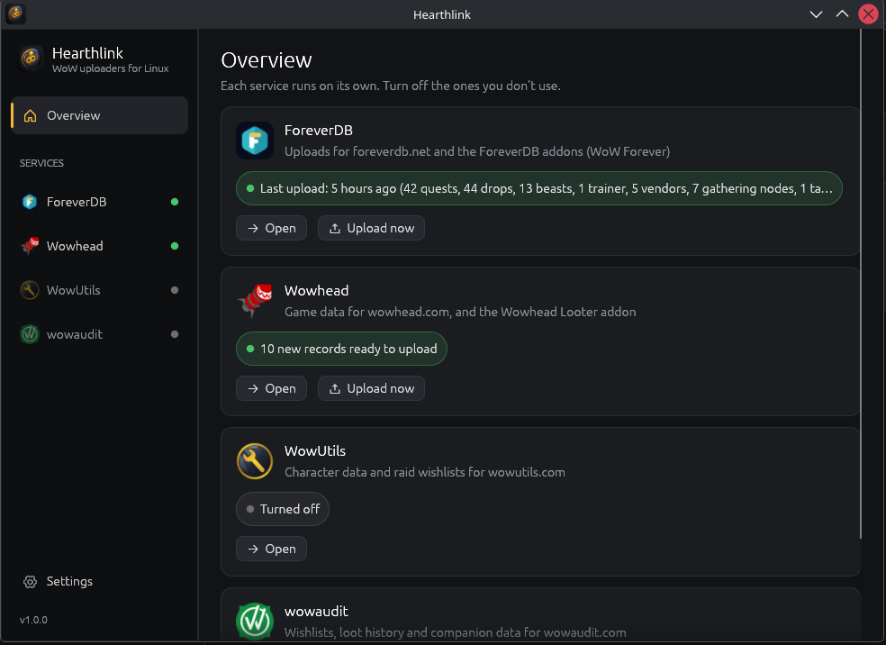
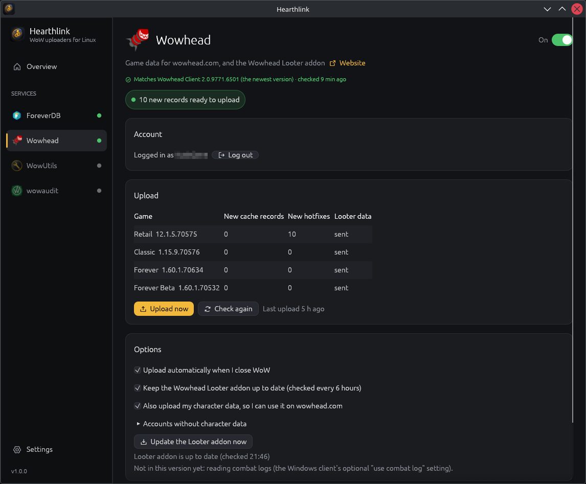

<p align="center"></p>

# Hearthlink: WoW data uploader for Linux

**Looking for the Wowhead Client, the WowUtils Bridge, the wowaudit client or the ForeverDB
Uploader on Linux?** Hearthlink does their job in one app with a tray icon, on any Linux
distribution, with the game running through Lutris, Wine, Bottles or Steam/Proton.

| Service | What Hearthlink does | Windows app it replaces |
|---|---|---|
| **Wowhead** | Uploads the game caches and Wowhead Looter data; keeps the Looter addon up to date | Wowhead Client |
| **WowUtils** | Sends your character data; writes your raid groups' wishlists and droptimizers into the game; sends RCLootCouncil's loot history to groups that take it | WowUtils Bridge |
| **ForeverDB** | Installs, updates and runs ForeverDB's official Linux uploader (WoW Forever) | ForeverDB Uploader |
| **wowaudit** | Writes your team's wishlists into RCLootCouncil (wowaudit module) / SimpleLootCouncil; sends RCLootCouncil loot history and WowauditCompanion data | wowaudit desktop client |

> **About wowaudit:** I don't use wowaudit myself, so this part is untested on my side: it was
> built from how the wowaudit desktop client works and checked against wowaudit's API where
> that was possible without a team, and I hope it works. If you use wowaudit, I'd be glad to
> hear whether it does (see [Bugs and wishes](#bugs-and-wishes)).

When one of the Windows apps gets a newer version than the one Hearthlink was built from,
the app tells you, since that version may send things Hearthlink doesn't know about yet.
Hearthlink also tells you when a new Hearthlink release is out.

## Screenshots

<p align="center">
  
  
</p>

## Install

Download the file for your system from the
[latest release](https://github.com/KushGene/hearthlink-linux/releases/latest).

| System | File | How |
|---|---|---|
| **Any distribution** (recommended) | `Hearthlink-<version>-x86_64.flatpak` | Open it in Discover / GNOME Software, or run `flatpak install --user Hearthlink-<version>-x86_64.flatpak` |
| **Fedora, openSUSE, Nobara, …** | `Hearthlink.x86_64.rpm` | Open it in Discover / GNOME Software, or run `sudo dnf install ./Hearthlink.x86_64.rpm` |
| **Debian, Ubuntu, Mint, Pop!_OS, …** | `Hearthlink.amd64.deb` | Open it in your software center, or run `sudo apt install ./Hearthlink.amd64.deb` |
| **Any distribution, no install** | `Hearthlink-<version>-x86_64.AppImage` | `chmod +x Hearthlink-*.AppImage` then double-click it |
| **Any distribution, no root** | `hearthlink-<version>-x86_64.tar.gz` | Unpack it and run `./install.sh` (installs to `~/.local`) |

Flatpak needs the Flathub runtime once:
`flatpak remote-add --if-not-exists --user flathub https://dl.flathub.org/repo/flathub.flatpakrepo`

Arch Linux: use the Flatpak, the AppImage or the tar.gz.

## First start

1. Hearthlink looks for World of Warcraft in the usual places (`~/Games`, Lutris, Wine,
   Bottles, Steam). If it doesn't find it, pick the folder under **Settings**.
2. Turn on the services you use and sign in where a service asks for it.
3. Under **Settings → App** you can start Hearthlink with your desktop session; it then waits
   in the tray and uploads after you play.

If the Windows Wowhead Client or WowUtils Bridge already ran in a Wine prefix, Hearthlink
takes over its login, upload history and raid group choice (wishlists and loot history).

## Addons

- **Wowhead Looter**: installed and kept up to date by Hearthlink (checked every 6 hours,
  never while the game runs).
- **ForeverDB addons**: installed and kept up to date by ForeverDB's uploader.
- **wowutils_data**: written by Hearthlink (your raid groups' data).
- **WowUtils**: install it with an addon manager (CurseForge, WowUp, Wago App); Hearthlink
  shows a hint when it's missing.
- **RCLootCouncil** (optional): its loot history goes to the raid groups you tick under
  WowUtils → Loot history, if a group admin allowed importing for the group.

## Update

The app shows a notice when a new release is out. Install the new file the same way as the
first one (Flatpak, rpm and deb replace the old version; for the AppImage replace the file;
for the tar.gz run `install.sh` again).

## Uninstall

Flatpak: `flatpak uninstall io.github.kushgene.Hearthlink` · rpm: `sudo dnf remove hearthlink` ·
deb: `sudo apt remove hearthlink` · tar.gz: `./uninstall.sh` · AppImage: delete the file.
Settings and logins are in `~/.config/hearthlink` and `~/.local/share/hearthlink` (Flatpak:
`~/.var/app/io.github.kushgene.Hearthlink`).

## Build from source

```sh
cargo build --release          # current stable Rust; needs no system libraries besides glibc
./target/release/hearthlink
```

Packages: `packaging/icons.sh`, then `cargo deb --no-build`, `cargo generate-rpm`,
`packaging/build-appimage.sh`; Flatpak via `packaging/io.github.kushgene.Hearthlink.yml`.
`.github/workflows/release.yml` builds all of them when a `v*` tag is pushed.

## Bugs and wishes

Found a bug, or something doesn't work the way the Windows app does? Is there a service or
uploader you'd like Hearthlink to support? Please
[open an issue](https://github.com/KushGene/hearthlink-linux/issues/new). For bugs, the app's
log (the service's page in Hearthlink) and your distribution help a lot.

## Disclaimer

Hearthlink is a community project. It is not made by, endorsed by or affiliated with
Blizzard Entertainment, Wowhead, WowUtils, wowaudit or ForeverDB. World of Warcraft is a
trademark of Blizzard Entertainment. Icons: [Phosphor](https://phosphoricons.com) (MIT).

License: MIT
