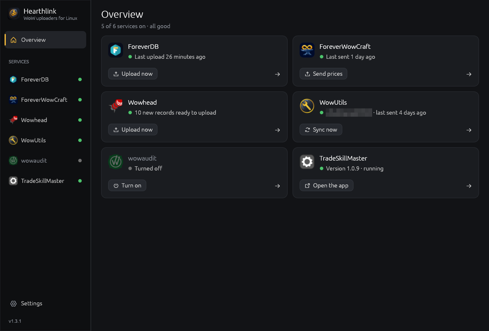
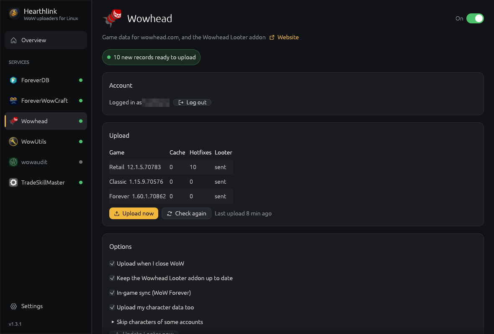
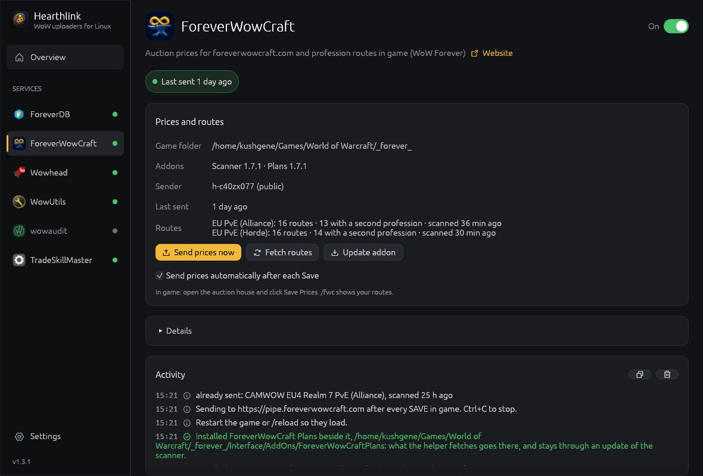
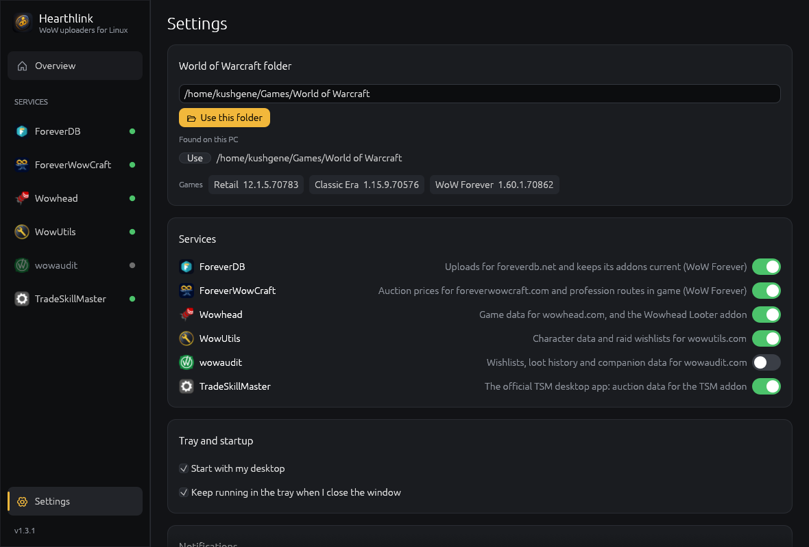

<p align="center"></p>

<h1 align="center">Hearthlink</h1>

<p align="center">
  <b>All your World of Warcraft uploaders in one Linux app.</b><br>
  For WoW running through Lutris, Wine, Bottles or Steam/Proton.
</p>

<p align="center">
  <a href="https://github.com/KushGene/hearthlink-linux/releases/latest"><b>Download</b></a> ·
  <a href="#install">Install</a> ·
  <a href="#questions">Questions</a> ·
  <a href="https://github.com/KushGene/hearthlink-linux/issues/new">Report a problem</a>
</p>

<p align="center">
  
</p>

The Wowhead Client, WowUtils Bridge, wowaudit client and the other uploaders only exist for
Windows. Hearthlink does their job on Linux: it sits in your tray, uploads after you play and
keeps the addons up to date.

## What it does

| Service | What Hearthlink does for you |
|---|---|
| **Wowhead** | Uploads game data and the Wowhead Looter addon's data, keeps the Looter up to date |
| **WowUtils** | Sends your character data, brings your raid's wishlists into the game, sends RCLootCouncil loot history |
| **wowaudit** | Brings your team's wishlists into RCLootCouncil / SimpleLootCouncil, sends loot history and WowauditCompanion data |
| **ForeverDB** | Runs ForeverDB's official uploader for WoW Forever and keeps it up to date |
| **ForeverWowCraft** | Runs the official ForeverWowCraft Helper: sends auction prices, brings your profession routes into the game |
| **TradeSkillMaster** | Installs, updates and starts TSM's official Linux app |

Turn on only the services you use. Already used the Windows Wowhead Client, WowUtils Bridge or
ForeverWowCraft Helper in Wine? Hearthlink picks up its login and settings.

<p align="center">
  
  
</p>

## Install

Download the file for your system from the
[latest release](https://github.com/KushGene/hearthlink-linux/releases/latest) and open it.

| Your system | File |
|---|---|
| **Any distribution** (recommended) | `Hearthlink-…-x86_64.flatpak` |
| Fedora, openSUSE, Nobara, … | `Hearthlink.x86_64.rpm` |
| Debian, Ubuntu, Mint, Pop!_OS, … | `Hearthlink.amd64.deb` |
| Any distribution, without installing | `Hearthlink-…-x86_64.AppImage` |

<details>
<summary>Install from the terminal, Arch Linux and other options</summary>

```sh
# Flatpak (needs Flathub once)
flatpak remote-add --if-not-exists --user flathub https://dl.flathub.org/repo/flathub.flatpakrepo
flatpak install --user Hearthlink-*-x86_64.flatpak

# Fedora / openSUSE
sudo dnf install ./Hearthlink.x86_64.rpm

# Debian / Ubuntu
sudo apt install ./Hearthlink.amd64.deb

# AppImage
chmod +x Hearthlink-*.AppImage && ./Hearthlink-*.AppImage

# tar.gz, without root (installs to ~/.local)
tar xf hearthlink-*-x86_64.tar.gz && cd hearthlink-*-x86_64 && ./install.sh
```

Arch Linux: use the Flatpak, the AppImage or the tar.gz.
</details>

## Getting started

1. **Open Hearthlink.** It finds World of Warcraft by itself in the usual places. If not, pick
   the folder under **Settings**.
2. **Turn on your services** and log in where a service asks for it.
3. **Done.** Hearthlink can start with your desktop and waits in the tray. Right-click the
   tray icon to upload right away, change notifications or open a service.

<p align="center">
  
</p>

## Updates

Hearthlink checks for new versions by itself and tells you when one is out. Click
**Install update**; your settings and logins are kept. Nothing is installed without your click.

## Questions

<details>
<summary><b>Which addons do I need?</b></summary>

Hearthlink installs and updates most of them for you: the Wowhead Looter, the ForeverDB addons
and the ForeverWowCraft addons. Install the **WowUtils** addon (and RCLootCouncil, if you use it)
with an addon manager like CurseForge, WowUp or the Wago App. Hearthlink shows a hint when one is
missing.
</details>

<details>
<summary><b>Do I need Python?</b></summary>

Only for ForeverWowCraft, whose official helper is a Python program. The Flatpak brings Python
along; the rpm and deb install it for you. Almost every distribution has it already.
</details>

<details>
<summary><b>The tray icon doesn't show up</b></summary>

GNOME needs the
[AppIndicator extension](https://extensions.gnome.org/extension/615/appindicator-support/).
Without a tray, closing the window only minimizes Hearthlink, so it keeps working.
</details>

<details>
<summary><b>Is this safe? What is sent?</b></summary>

Hearthlink sends the same data the official Windows apps send, to the same sites. For
ForeverDB, ForeverWowCraft and TradeSkillMaster it runs the official apps themselves, downloaded
from their makers and checked against their checksums.
</details>

<details>
<summary><b>wowaudit</b></summary>

I don't use wowaudit myself, so this part was built from how the wowaudit client works but
isn't tested by me. If you use it, please tell me whether it works.
</details>

<details>
<summary><b>Uninstall</b></summary>

Flatpak: `flatpak uninstall io.github.kushgene.Hearthlink` · rpm: `sudo dnf remove hearthlink` ·
deb: `sudo apt remove hearthlink` · tar.gz: `./uninstall.sh` · AppImage: delete the file.
Settings and logins are in `~/.config/hearthlink` and `~/.local/share/hearthlink`
(Flatpak: `~/.var/app/io.github.kushgene.Hearthlink`).
</details>

<details>
<summary><b>Build from source</b></summary>

```sh
cargo build --release
./target/release/hearthlink
```

Packages are built by `.github/workflows/release.yml` when a `v*` tag is pushed.
</details>

## Problems and wishes

Something doesn't work, or you'd like another uploader in Hearthlink?
[Open an issue](https://github.com/KushGene/hearthlink-linux/issues/new). The **Activity** list
on the service's page (copy button at its top right) and your distribution help a lot.

---

<sub>Hearthlink is a community project, not made by or affiliated with Blizzard Entertainment,
Wowhead, WowUtils, wowaudit, ForeverDB, ForeverWowCraft or TradeSkillMaster. World of Warcraft is
a trademark of Blizzard Entertainment. Service logos belong to their owners and only show which
service a page is about. The official apps Hearthlink runs are downloaded from their makers and
are not part of Hearthlink. Icons: [Phosphor](https://phosphoricons.com) (MIT). License: MIT.</sub>
